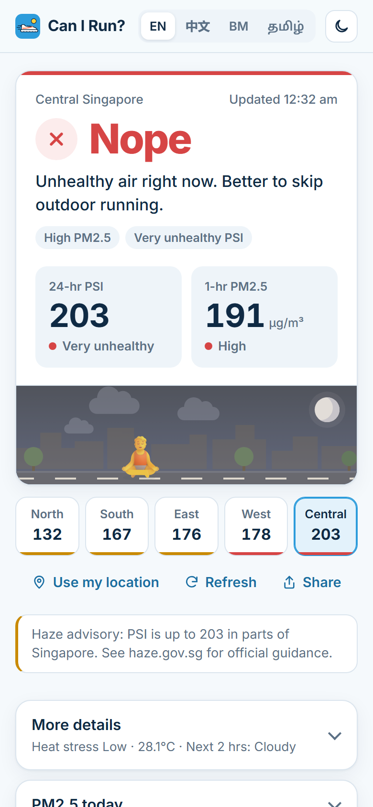

# Can I Run Today? · Singapore

A clear Yes / Maybe / Nope on whether it's a good time to run outdoors in Singapore, based on live NEA data.

**Live:** https://can-i-run-sg.vercel.app



## What it checks

- **Haze:** 24-hour PSI and 1-hour PM2.5 for NEA's five regions
- **Heat stress:** WBGT from the nearest NEA station
- **Weather:** 2-hour nowcast, thundery showers and lightning within 10 km
- **UV index**

The verdict takes the worst signal: any red flag means Nope, smaller warnings mean Maybe. It's guidance for healthy adults, not medical advice. Follow [haze.gov.sg](https://www.haze.gov.sg) advisories.

## Features

- English, 中文, Bahasa Melayu and தமிழ்
- Add to home screen (PWA), works offline with the last saved data
- Run streak, calendar and badges, stored only on your device
- Share card with the day's verdict and key numbers
- Links can preset language and region, e.g. `?lang=zh&region=east`

## Getting started

Requires Node 20 or later. There are no dependencies to install.

```
npm run dev     # http://localhost:5173, using live data from the deployed API
npm test        # verdict rules, NEA parsing, streaks, translations
npm run deploy  # needs the Vercel CLI
```

Set `DATA_GOV_SG_API_KEY` as a Vercel environment variable for higher NEA rate limits. The app also works without one.

## Project structure

```
api/conditions.js   Vercel function: combines six NEA APIs into one cached response
src/
  verdict.js        the Yes / Maybe / Nope rules (pure, tested)
  conditions.js     parses NEA data and finds readings for a region (pure, tested)
  forecast.js       best running window from the 24-hour forecast (pure, tested)
  streak.js         run log, streaks and badges (pure, tested)
  regions.js        NEA's five regions and distance helpers
  app.js            entry point: loads data and wires up controls
  render.js         draws the page from state
  onboarding.js     welcome screen and add-to-home-screen guide
  share.js          share image
  i18n.js, strings.js   translations
tests/              node:test suites
tools/serve.mjs     local dev server
```

## Decisions

**A server function in front of NEA.** The app needs six NEA APIs. Calling them from every visitor's browser hit data.gov.sg's rate limit within a few page loads. One Vercel function fetches them together, keeps the API key off the client, and caches the result at the edge for five minutes, so NEA sees a handful of requests no matter how many people visit.

**The worst signal wins.** A runner cares about the one thing that should stop them, not an average. Air quality is checked first, so when several signals are equally bad, the advice talks about the haze.

**1-hour PM2.5 matters more than 24-hour PSI.** PSI is the official headline number but it lags by hours. PM2.5 shows the air right now, which is what you breathe on a run.

**A website, not an app-store app.** It installs to the home screen, works offline, costs nothing to run, and updates instantly without review.

**No framework or build step.** The app is a few hundred lines of plain JavaScript modules. Keeping it dependency-free means it loads fast and anyone can read it.

## Credits

Built with the help of [Claude](https://claude.ai). Data © NEA, via [data.gov.sg](https://data.gov.sg).
